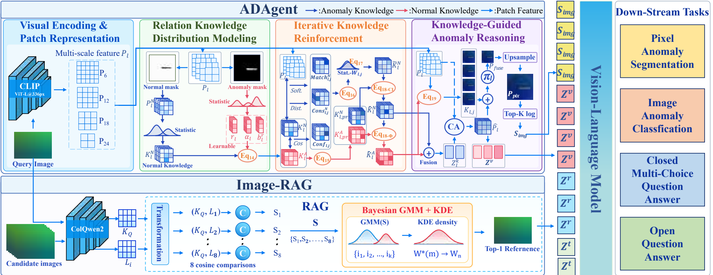
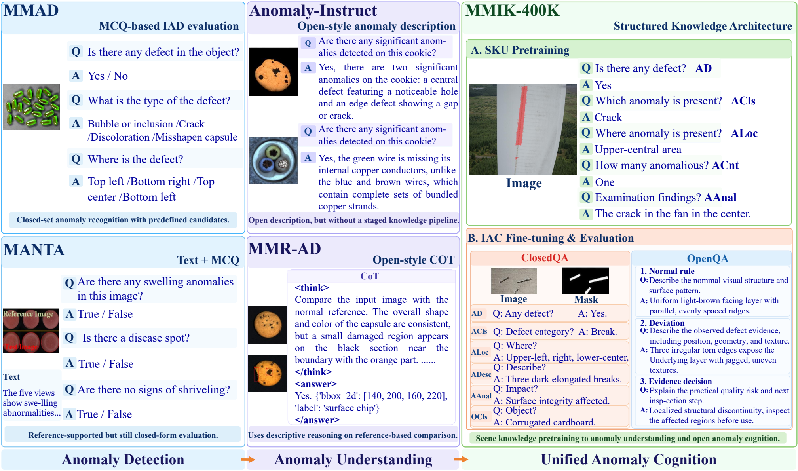
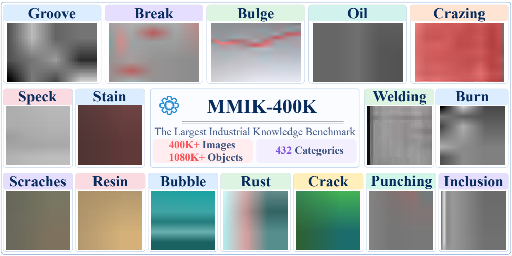
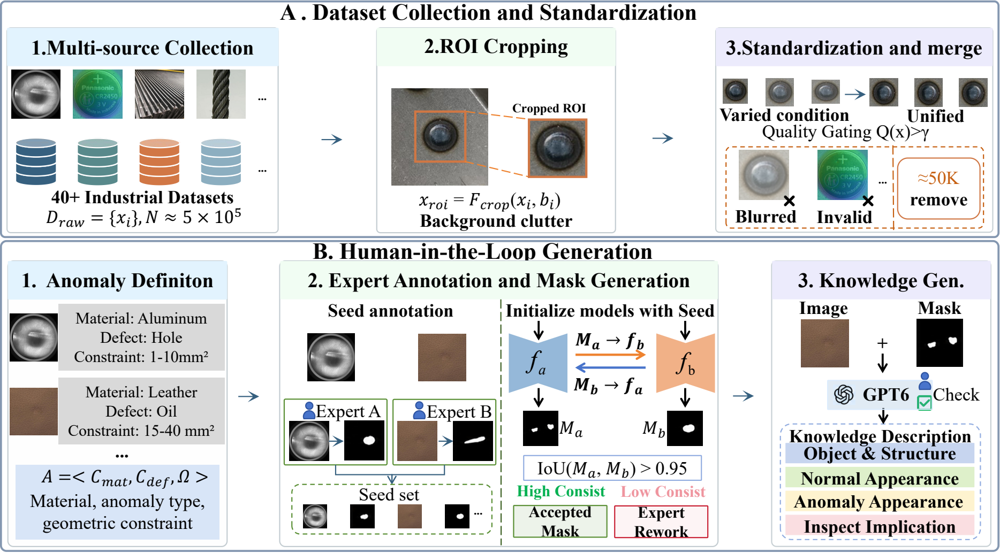
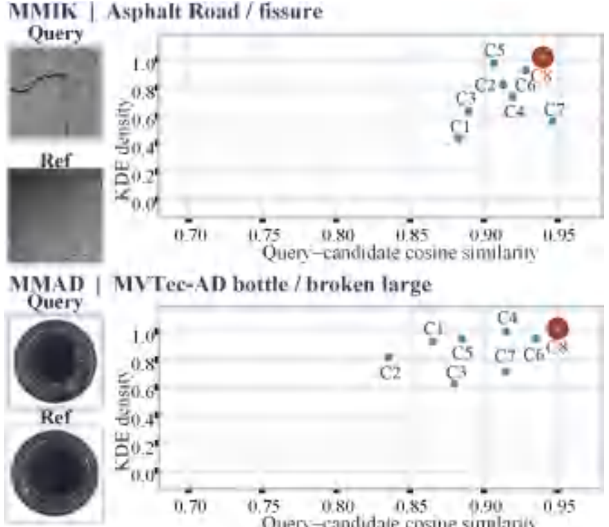
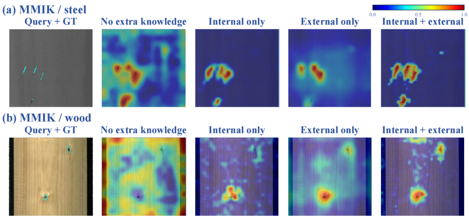

<div align="center">

# ADSeeker++

### Towards Industrial Anomaly Cognition

**A knowledge-guided vision-language framework and the MMIK-400K benchmark**

[](Towards_Industrial_Anomaly_Cognition.pdf)
[](#mmik-400k-benchmark)
[](#mmik-400k-benchmark)

[Overview](#overview) · [Benchmark](#mmik-400k-benchmark) · [Method](#adseeker-method) · [Results](#results) · [Usage](#usage-for-the-complete-project) · [Paper](#paper)

</div>

---

## Overview

**ADSeeker++** brings two kinds of visual evidence into industrial question answering: an anomaly heatmap from **ADAgent** and a relevant normal image retrieved by **Image-RAG**. **Qwen3-VL** uses both alongside the query image to reason about defects. The accompanying **MMIK-400K** benchmark spans scene knowledge, closed-form inspection questions, and open-ended anomaly cognition.

> [!NOTE]
> **Release status.** This repository currently publishes the project homepage, paper, and figures. Source code, datasets, indexes, and checkpoints are being prepared for release. The usage commands below describe the complete project and require those files.

<p align="center">
  
</p>
<p align="center"><sub>Figure 7 · ADAgent contributes anomaly evidence, while Image-RAG retrieves a normal reference for vision-language reasoning.</sub></p>

### At a glance

| 461,388 | 432 | 1,271,155 | 133,140 |
| :---: | :---: | :---: | :---: |
| Industrial images | Object categories | Closed QA pairs | Open QA pairs |

*Dataset statistics reported in the accompanying paper.*

## MMIK-400K benchmark

MMIK-400K connects **scene knowledge pretraining**, **structured ClosedQA**, and **open-ended OpenQA**. Its images, masks, and questions are organized around industrial anomaly understanding.

<p align="center"></p>
<p align="center"><sub>Figure 3 · Three complementary task paradigms in MMIK-400K.</sub></p>

<p align="center"></p>
<p align="center"><sub>Figure 4 · Representative categories and anomaly appearances.</sub></p>

The paper describes multi-source collection, region-of-interest standardization, expert-reviewed masks, and associated knowledge annotations.

<p align="center"></p>
<p align="center"><sub>Figure 2 · From source images to masks and knowledge annotations.</sub></p>

## ADSeeker++ method

| Component | Evidence delivered to the VLM |
| :--- | :--- |
| **Image-RAG** | A top-1 normal reference selected from the query's eight candidates using ColQwen similarity, optionally with a KDE-GMM distribution term. |
| **ADAgent** | An anomaly heatmap loaded from cache or generated from a detector checkpoint. |
| **Qwen3-VL + task LoRA** | The answer conditioned on the query image, normal reference, heatmap, and question. |

<p align="center"></p>
<p align="center"><sub>Figure 13 · Similarity and candidate-density modeling guide reference selection.</sub></p>

<p align="center"></p>
<p align="center"><sub>Figure 11 · Internal and external knowledge offer complementary evidence.</sub></p>

## Results

The paper reports the following **ADSeeker++** results. ClosedQA is mean accuracy over seven tasks; OpenQA averages Normal Rule, Deviation, and Evidence Decision.

| Benchmark | Metric | Result |
| :--- | :--- | ---: |
| MMAD ClosedQA | Accuracy ↑ | **79.69%** |
| MMIK-400K ClosedQA | Accuracy ↑ | **60.76%** |
| MMIK-400K OpenQA | ROUGE-L ↑ | **26.71** |
| MMIK-400K OpenQA | BERTScore ↑ | **89.19** |
| MMIK-400K OpenQA | SBERT ↑ | **57.43** |

See Table 8 in the [paper](Towards_Industrial_Anomaly_Cognition.pdf) for the complete evaluation context.

## Repository map

| Component | Purpose |
| --- | --- |
| `ADAgent/` | Train and evaluate the detector, or generate a heatmap for one image. |
| `Image-RAG/` | Retrieve one normal reference from eight candidates using ColQwen similarity and optional KDE-GMM. |
| `VLM/` | Run MMAD, MMIK-400K ClosedQA, and MMIK-400K OpenQA with Qwen3-VL + task LoRA. |
| `ADAgent_Heatmap/` | Cached heatmaps and query-to-heatmap manifests for the three VLM tasks. |
| `Data/` | The `newnew/` image/annotation collection and `MMIK-400K-IAC/` images, masks, and QA splits. |

In the complete project, each folder above has its own task split and file layout.

## Usage for the complete project

The following commands document the complete local project. They require the source code and model assets, which have not yet been published in this GitHub repository.

<details>
<summary><strong>Show environment setup, inference, and evaluation commands</strong></summary>

Run the following commands from the complete project root. The detector and VLM pin different PyTorch versions, so install them in separate environments. Python 3.10 and an NVIDIA GPU are recommended for the provided checkpoints.

```bash
cd /path/to/ADSeeker_code_reorg
export REPO="$PWD"
export RUNS="${TMPDIR:-/tmp}/adseeker_demo"
mkdir -p "$RUNS"

python3 -m venv .venv-vlm
. .venv-vlm/bin/activate
python -m pip install -r VLM/MMAD/requirements.txt -r Image-RAG/I-RAG/requirements.txt
deactivate

python3 -m venv .venv-adagent
. .venv-adagent/bin/activate
python -m pip install -r ADAgent/requirements.txt
deactivate

export VLM_PYTHON="$REPO/.venv-vlm/bin/python"
export ADAGENT_PYTHON="$REPO/.venv-adagent/bin/python"
export CUDA_VISIBLE_DEVICES=0
export HF_HUB_OFFLINE=1
export TRANSFORMERS_OFFLINE=1
```

The commands expect these local assets:

```text
ADAgent/weight/backbone/ViT-L-14-336px.pt
ADAgent/weight/<task>/final_model.pth
Image-RAG/I-RAG/models/
Image-RAG/MMAD/{candidate_images,colqwen_index,manifests}/
Image-RAG/MMIK-400K/shared/{candidate_images,colqwen_index,manifests}/
VLM/<task>/{base_model,sft_adapter}/
Data/MMIK-400K-IAC/
```

The complete local project uses large datasets, indexes, and checkpoints. The GitHub documentation-only checkout cannot run these commands yet. Cached heatmap inference also requires `ADAgent_Heatmap/`.

## Quick start

### 1. Generate a heatmap with ADAgent

```bash
"$ADAGENT_PYTHON" ADAgent/ADAgent.py infer \
  --checkpoint weight/MMIK/final_model.pth \
  --image "$REPO/Data/MMIK-400K-IAC/Asphalt Road/test/fissure/005.jpg" \
  --output-dir "$RUNS/adagent_single" --device cuda:0
```

The output contains a grayscale heatmap, an overlay, a float-map NPZ, and a JSON score. Other checkpoints and full training/test commands are listed in `ADAgent/README.md`.

### 2. Retrieve a normal reference with Image-RAG

```bash
"$VLM_PYTHON" Image-RAG/I-RAG/run_irag.py \
  --task mmik-openqa \
  --query 'MMIK-400K-IAC/Asphalt Road/test/Artificial blurring/001.jpg' \
  --device cuda:0 --gmm --output-dir "$RUNS/irag_single"
```

The result contains the selected reference and retrieval record. Use `--task mmik-closedqa` or `--task mmad` for the other indexes. See `I-RAG/README.md` for batch retrieval.

### 3. Ask Qwen3-VL using cached heatmaps

**MMIK-400K ClosedQA**

```bash
"$VLM_PYTHON" 'VLM/MMIK-400K ClosedQA/infer.py' \
  --query 'MMIK-400K-IAC/Iron filings/test/good/032.jpg' \
  --question 'Is there an anomaly in the query image?' \
  --options-json '{"A":"Yes","B":"No"}' \
  --gmm --device cuda:0 --output "$RUNS/mmik_closedqa.json"
```

**MMIK-400K OpenQA**

```bash
"$VLM_PYTHON" 'VLM/MMIK-400K OpenQA/infer.py' \
  --query 'MMIK-400K-IAC/Asphalt Road/test/Artificial blurring/001.jpg' \
  --question 'Describe the visible deviation from a normal road surface.' \
  --gmm --device cuda:0 --output "$RUNS/mmik_openqa.json"
```

**MMAD ClosedQA**

```bash
"$VLM_PYTHON" VLM/MMAD/infer.py \
  --query 'DS-MVTec/bottle/image/broken_large/000.png' \
  --question 'Is there an anomaly in the query image?' \
  --options-json '{"A":"Yes","B":"No"}' \
  --gmm --device cuda:0 --output "$RUNS/mmad_closedqa.json"
```

MMAD query images are read from the dataset location expected by the local manifest. If the dataset is elsewhere, pass `--query-image /absolute/path/to/query.png`. Add `--dry-run` to check resources without loading Qwen. The cached MMIK ClosedQA heatmaps cover a subset of test queries; use a query listed in its manifest.

### 4. Run the detector and VLM together

Use `infer_joint.py` to generate a heatmap from a checkpoint in the same request:

```bash
"$VLM_PYTHON" 'VLM/MMIK-400K OpenQA/infer_joint.py' \
  --query 'MMIK-400K-IAC/Asphalt Road/test/Artificial blurring/001.jpg' \
  --question 'Describe the visible deviation from a normal road surface.' \
  --adagent-checkpoint "$REPO/ADAgent/weight/MMIK/final_model.pth" \
  --adagent-python "$ADAGENT_PYTHON" --adagent-device cuda:0 \
  --gmm --device cuda:0 --output "$RUNS/mmik_openqa_joint.json"
```

Both modes retrieve a reference through Image-RAG. Commands for each task/mode and their output formats are collected in `VLM/INFERENCE_COMMANDS.md`.

### 5. Train or evaluate ADAgent

```bash
"$ADAGENT_PYTHON" ADAgent/ADAgent.py train --config reproduce/MMIK/train.json
"$ADAGENT_PYTHON" ADAgent/ADAgent.py test  --config reproduce/MMIK/test_mula.json
```

The training configuration writes new checkpoints under `ADAgent/outputs/MMIK/train/`. The VLM directory provides inference bundles; it does not contain a Qwen SFT training entry point.

</details>

## Paper

**Zekai Zhang et al.**, *Towards Industrial Anomaly Cognition: A Large-Scale Knowledge Benchmark, Challenges, and Baselines* (2026). Figures on this page are cropped from the [paper PDF](Towards_Industrial_Anomaly_Cognition.pdf): Figs. 2, 3, 4, 7, 11, and 13.
