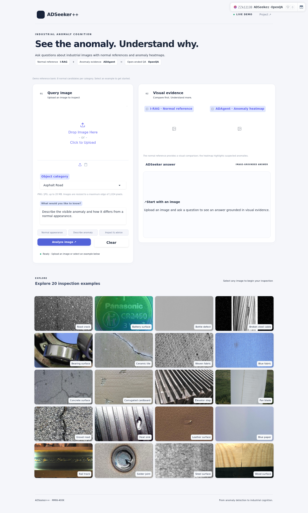
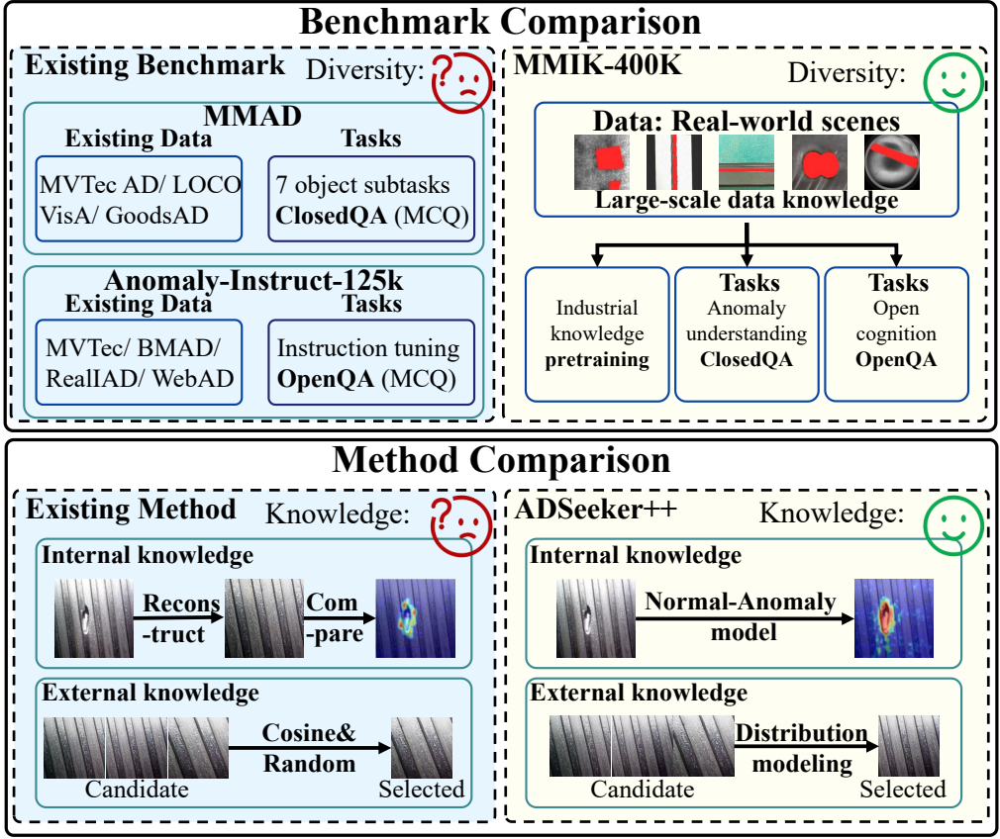

<div align="center">

# Towards Industrial Anomaly Cognition
### A Large-Scale Knowledge Benchmark, Challenges, and Baselines

**Submitted to IEEE Transactions on Pattern Analysis and Machine Intelligence (TPAMI)**

**Zekai Zhang · Qinghui Chen · Da Chen · Gang Li · Changlin Bian · Yunlong Liu · Tao Zhou · Cong Liu · Jinglin Zhang* · Cong Bai · Shengyong Chen · Laurent D. Cohen**

Shandong University · University Paris Dauphine–PSL · Qilu University of Technology · NOVA IMS · Zhejiang University of Technology · Tianjin University of Technology

[**Live demo ↗**](https://huggingface.co/spaces/ZZk12138/ADSeeker-OpenQA) &nbsp;|&nbsp; [Project page](https://hellozzk.github.io/MMIK-400K/) &nbsp;|&nbsp; <a href="https://huggingface.co/datasets/ZZk12138/MMIK-400K-IAC"> MMIK-400K-IAC dataset</a> &nbsp;|&nbsp; <a href="#model-weights"> Model weights</a> &nbsp;|&nbsp; [Visual examples](#visual-examples) &nbsp;|&nbsp; [Results](#results)

<p>
  <a href="https://huggingface.co/spaces/ZZk12138/ADSeeker-OpenQA"></a>
</p>

**Upload an image. Retrieve a normal reference. Explore the anomaly.**<br>
[**Launch the interactive demo →**](https://huggingface.co/spaces/ZZk12138/ADSeeker-OpenQA) · [How to use](#online-demo)

</div>

> **Release status:** The interactive demo, project page, MMIK-400K-IAC dataset, and three model weight bundles are available. The full paper PDF is temporarily withheld. The full MMIK-400K collection and source-code release are in preparation. The online demo loads its inference engine and supporting resources privately.

## Online demo

### Try ADSeeker in your browser

**[Open the live demo on Hugging Face →](https://huggingface.co/spaces/ZZk12138/ADSeeker-OpenQA)** — no installation or local GPU required.

<p align="center"><a href="https://huggingface.co/spaces/ZZk12138/ADSeeker-OpenQA"></a></p>

1. **Choose an image.** Upload a PNG/JPG image (up to 20 MB), or click one of the 20 inspection examples.
2. **Select the object category.** Choose the category matching your image so Image-RAG can search its normal reference candidates. Selecting an example sets its category automatically.
3. **Ask a question.** Enter your question, or use **Normal appearance**, **Describe anomaly**, or **Impact & advice**.
4. **Click Analyze image.** The app retrieves a normal reference with **ColQwen + GMM**, generates an **ADAgent anomaly heatmap**, and supplies the reference, heatmap, and query image to the **OpenQA Qwen3-VL-4B model**.
5. **Explore the answer.** View the retrieved reference, heatmap overlay, and generated explanation. Change the question to inspect another aspect, or select **Clear** to start again.

**Example question:** “Describe the visible anomaly and how it differs from a normal appearance.”

The English interface currently supports **32 categories**, with **8 original normal candidates per category**. This lightweight demo uses the MMIK-400K OpenQA model; it is separate from the complete benchmark evaluation. The full 19,200-image normal reference bank has been prepared privately and is not enabled in the live demo.

**Availability:** The app runs on free Hugging Face ZeroGPU. Cold starts, the first request for a category, GPU queues, and platform usage quotas can add waiting time. If the app is sleeping, allow it to start before analyzing an image. The public Space contains only a minimal launcher; the inference engine and supporting resources remain private.

## Abstract

Industrial inspection is moving from detecting unusual regions to explaining anomalies and making informed decisions. Existing benchmarks often separate detection, closed questions, and open reasoning; existing multimodal methods can also use normal references without checking whether they match the query. We introduce **MMIK-400K**, a benchmark that connects scene knowledge pretraining, anomaly understanding, and open-ended cognition, and **ADSeeker++**, a baseline that combines two complementary sources of evidence. **ADAgent** learns normal-to-anomaly relations within the query image. **Image-RAG** selects a relevant normal image by modeling its similarity and distribution among the query's candidate references. A vision-language model brings those signals together to answer inspection questions.

<p align="center"></p>
<p align="center"><sub>Figure 1 · The benchmark unifies cognition tasks; the method combines internal and external visual knowledge.</sub></p>

## Contributions

- **MMIK-400K:** 461,388 real industrial images from 432 object categories, with 1,271,155 closed QA pairs and 133,140 open QA pairs across a continuous knowledge-to-cognition pipeline.
- **ADSeeker++:** ADAgent models normal-to-anomaly relations, while Image-RAG retrieves a query-relevant normal reference from the official candidate pool.
- **Evaluation:** ClosedQA and OpenQA experiments on MMIK-400K and MMAD examine anomaly understanding, evidence selection, and the effect of each knowledge source.

## Visual examples

The three images below are **actual inputs produced for one MMAD query**. Image-RAG selected the normal bottle from eight official candidates with GMM enabled; the heatmap was generated using the ADAgent MVTECAD checkpoint. This panel does not display a Qwen answer.

| Query · broken bottle rim | Image-RAG · selected normal reference | ADAgent · anomaly heatmap |
| :---: | :---: | :---: |
|  |  |  |

<sub>Query and reference: [MVTec AD](https://www.mvtec.com/research-teaching/datasets/mvtec-ad), [CC BY-NC-SA 4.0](https://creativecommons.org/licenses/by-nc-sa/4.0/). The heatmap overlay was generated from the query image.</sub>

The [project page](https://hellozzk.github.io/MMIK-400K/) also includes an MMIK-400K asphalt-road example with a retrieved normal image and ADAgent heatmap.

## Method

The full system has two evidence paths. **ADAgent** models internal visual knowledge by relating normal distributions to anomalous regions. **Image-RAG** evaluates the query's normal candidates with ColQwen similarity and optional KDE-GMM distribution modeling, then supplies one reference. Qwen3-VL receives the query, selected reference, heatmap, and task question.

<p align="center"></p>
<p align="center"><sub>Figure 7 · ADSeeker++ architecture. Open the image to inspect the high-resolution version.</sub></p>

## MMIK-400K benchmark

MMIK-400K connects **scene knowledge pretraining**, **ClosedQA anomaly understanding**, and **OpenQA anomaly cognition**. The OpenQA tasks ask for a normal rule, an explanation of the deviation, and an evidence-based decision.

<p align="center"></p>
<p align="center"><sub>Figure 3 · MMIK-400K joins scene knowledge with structured and open-ended anomaly questions.</sub></p>

<details>
<summary><b>Representative categories and anomaly types</b></summary>

<p align="center"></p>
<p align="center"><sub>Figure 4 · The high-resolution crop is taken from the latest paper PDF.</sub></p>

</details>

## Results

The paper reports the following **ADSeeker++-4B** results. ClosedQA values are mean accuracy over seven tasks; OpenQA values are averages over Normal Rule, Deviation, and Evidence Decision.

| Setting | MMAD ClosedQA ↑ | MMIK-400K ClosedQA ↑ | OpenQA ROUGE-L ↑ | OpenQA BERTScore ↑ | OpenQA SBERT ↑ |
| :--- | ---: | ---: | ---: | ---: | ---: |
| Without Image-RAG | 71.34 | 55.68 | 22.38 | 86.84 | 50.65 |
| **With Image-RAG** | **79.69** | **60.76** | **26.71** | **89.19** | **57.43** |

*Source: Table 13 of the manuscript. The two rows use the reported ADSeeker++-4B configurations; the complete evaluation protocol will be available with the paper.*

## Resources

| Resource | Availability |
| :--- | :--- |
| Extended paper PDF | Temporarily withheld |
| [Live demo](https://huggingface.co/spaces/ZZk12138/ADSeeker-OpenQA) | Available · OpenQA · free ZeroGPU |
| [Project page](https://hellozzk.github.io/MMIK-400K/) | Available |
|  [MMIK-400K-IAC dataset](https://huggingface.co/datasets/ZZk12138/MMIK-400K-IAC) | 32 categories and 59,740 images; available |
| Training and inference code | In preparation |
| Full MMIK-400K data and QA annotations | In preparation |
| ADAgent checkpoints | In preparation |

### Model weights

Each model bundle contains the Qwen3-VL-4B-Instruct base, processor files, and its task-specific LoRA adapter. Only model files and loading configuration are uploaded; training and inference code are not included. All three model bundles have completed upload verification and are publicly available.

| Task | Hugging Face weights |
| :--- | :--- |
| MMAD ClosedQA |  [ADSeeker-MMAD-Qwen3-VL-4B-LoRA](https://huggingface.co/ZZk12138/ADSeeker-MMAD-Qwen3-VL-4B-LoRA) |
| MMIK-400K ClosedQA |  [ADSeeker-MMIK-400K-ClosedQA-Qwen3-VL-4B-LoRA](https://huggingface.co/ZZk12138/ADSeeker-MMIK-400K-ClosedQA-Qwen3-VL-4B-LoRA) |
| MMIK-400K OpenQA |  [ADSeeker-MMIK-400K-OpenQA-Qwen3-VL-4B-LoRA](https://huggingface.co/ZZk12138/ADSeeker-MMIK-400K-OpenQA-Qwen3-VL-4B-LoRA) |

Related prior work: [ADSeeker (CVPR 2026)](https://openaccess.thecvf.com/content/CVPR2026/html/Zhang_ADSeeker_A_Knowledge-Grounded_Reasoning_Framework_for_Industry_Anomaly_Detection_and_CVPR_2026_paper.html). This repository currently publishes research documentation and paper-derived figures; commands for training and evaluation will be added with the code release.

## Prior work citation (CVPR 2026)

```bibtex
@InProceedings{Zhang_2026_CVPR,
  author={Zhang, Kai and Zhang, Zekai and Sun, Xihe and Wang, Anpeng and Nie, Jingmeng and Chen, Qinghui and Hao, Han and Guo, Jianyuan and Zhang, Jinglin},
  title={ADSeeker: A Knowledge-Grounded Reasoning Framework for Industry Anomaly Detection and Reasoning},
  booktitle={Proceedings of the IEEE/CVF Conference on Computer Vision and Pattern Recognition (CVPR)},
  month={June},
  year={2026},
  pages={21379--21388}
}
```

<sub>Figures 1, 3, 4, and 7 are cropped from the manuscript. For questions or corrections, open an [issue](https://github.com/hellozzk/MMIK-400K/issues).</sub>
